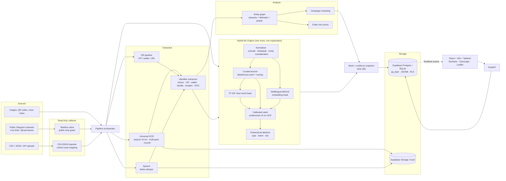

# SPECTRA — Social Platform Entity Correlation & Threat Recognition Analytics

OSINT prototype that monitors **public** Telegram channels (and imported
CSV/JSON) for illegal sales — drugs, arms, fake documents — and mule-account
recruitment (sale/rent of bank accounts, ATM cards, SIMs, net-banking kits).

It extracts seller identifiers from **text, images (OCR), QR codes (UPI) and
voice notes (speech-to-text)**, links them across channels in an entity graph,
groups coordinated ads into campaigns, and raises alerts with **tamper-evident
SHA-256 evidence snapshots** that an analyst can verify in one click.

Runs fully offline on macOS, Linux and Windows. No cloud account required for
the demo (SQLite + local storage); Supabase is optional.

---

## Contents

- [Status: what's done, what's left](#status-whats-done-whats-left)
- [Requirements](#requirements)
- [Quick start](#quick-start)
  - [macOS](#macos)
  - [Linux](#linux)
  - [Windows](#windows)
  - [Docker (any OS, most reproducible)](#docker-any-os-most-reproducible)
- [Optional: Supabase, Telegram, voice notes](#optional-supabase-telegram-voice-notes)
- [What you get](#what-you-get)
- [How it works](#how-it-works)
- [API](#api)
- [Tests and benchmarks](#tests-and-benchmarks)
- [Troubleshooting](#troubleshooting)
- [Limitations](#limitations)

---

## Status: what's done, what's left

### Done (working, tested)

| Area | State |
|---|---|
| Hybrid classifier: lexicon + TF-IDF (char/word) + multilingual MiniLM embedding head + calibrated fusion | ✅ held-out **macro-F1 0.950**, end-to-end pipeline **0.958** |
| Normalisation: leetspeak (`w33d`, `m@al`), emoji→tokens, Devanagari→Roman, Devanagari digits, Hinglish spelling | ✅ |
| Hard negatives (weed killer, cookies, SIM store, savings account, toy guns, pharmacy) | ✅ **0 of 240 flagged** |
| Financial-ad detector: type / intent (BUY·SELL·RENT) / risk HIGH·MEDIUM·LOW + evidence phrases | ✅ incl. legitimate-store veto |
| Identifier extraction: phones (spaced, spelled EN/HI, Devanagari), UPI (+`(at)` obfuscation), BTC/ETH/TRX wallets (EIP-55 Keccak), usernames, links, locations, banks/IFSC | ✅ with `source` = text / image_ocr / qr / voice |
| OCR: easyocr en+hi, multi-pass preprocessing, token voting, identifier-crop recycling, pytesseract fallback | ✅ |
| QR: UPI `upi://pay?pa=…&pn=…&am=…`, wallet, URL | ✅ **39/40** on clean/noisy/low-res/rotated |
| Voice: ffmpeg → faster-whisper, timestamps, spoken-digit compaction | ✅ (needs ffmpeg) |
| Entity graph + campaigns (MinHash text, pHash image, shared identifiers), 1–3 hop subgraph, entity risk | ✅ phone `+919000011111` links **14 channels** |
| Alerts + immutable evidence + SHA-256 verify + New→Under review→Confirmed→Dismissed + audit log + notes | ✅ 50/50 verification checks pass |
| Dashboard: Overview, Ingest & Analyze, Alerts, Entity Graph, Campaigns, Identifier Registry, Map, Model Metrics, Lexicon — EN/हिंदी toggle | ✅ |
| PDF evidence reports (alert + campaign), CSV export, active-learning feedback, lexicon editor with live reload | ✅ |
| Seeds / synthetic dataset: 2 108 posts, 14 channels, posters + UPI QRs, Hinglish voice notes, ground truth | ✅ |
| Tests | ✅ **76 passing** (extractors, engine, API, OCR/QR/speech) |
| Supabase schema with pg_trgm, JSONB, RLS, Realtime publication | ✅ SQL included → see [DEPLOYMENT.md](docs/DEPLOYMENT.md) |
| Cross-platform: macOS · Linux · Windows · Docker | ✅ (this release) |

### Left / not production-ready

| Item | Why / next step |
|---|---|
| **Cold `make run` is not 3 min on small machines** | Measured 5–10 min on a 2-vCPU VM (training + embedding 2 100 posts). On a normal 4–8 vCPU laptop it lands near the 3-minute target. Subsequent runs start in seconds. `make seed-quick` is the sub-minute demo path. |
| **Unseen-slang paraphrase holdout ≈ 33 %** | The embedding head alone scores 0.95, but genuinely novel metaphors need analyst feedback. Active learning is wired in (`POST /feedback` → retrain). |
| **Telegram collector untested against live API** | No credentials/session in the build environment. Scope guards, rate limiting, resumable cursor and demo mode are implemented; needs one real run with `make telegram-login`. |
| **Supabase path unverified end-to-end** | No Postgres reachable here; migrations and RLS are written and reviewed but only the SQLite path is exercised. |
| **Docker image not built here** | No Docker in the build environment; Dockerfile is complete but first build must be verified on a machine with Docker. |
| **OCR throughput** | CPU-only: a large poster takes ~40–120 s depending on host. Production wants GPU or a worker pool. |
| **Whisper `base` on Hinglish** | Numbers are reliable, some Hindi words mis-spelled. A `medium`/`large-v3` model improves transcripts at higher cost. |
| **Graph scale** | In-memory networkx rebuild per request; fine to ~10⁴ posts. Beyond that, persist the graph (AGE / Neo4j). |
| **Auth** | Demo runs `AUTH_MODE=open`; set `AUTH_MODE=jwt` + Supabase Auth + RLS for real analyst access control. |
| **Organisers' sample dataset** | `/data/sample` was not present at build time. The importer auto-maps its columns; drop it in `data/sample/` and re-seed to include it. |

---

## Requirements

| | Minimum | Notes |
|---|---|---|
| Python | **3.11 or 3.12** | 3.13 is untested (torch 2.4.1 wheels). 3.10 works but is untested. |
| Node.js | **20 LTS** (18+ likely fine) | only for the dashboard build |
| RAM | 8 GB free | embedding + OCR models |
| Disk | ~4 GB | venv + torch + models + data |
| CPU | any x86-64 / arm64 | **no GPU needed** (CPU-only inference) |
| System tools | `ffmpeg` for voice notes | optional; everything else works without it |

`python3 --version`, `node --version`, `ffmpeg -version` to check.

---

## Quick start

All platforms follow the same three steps:

1. **Install Python 3.11/3.12 and Node.js 20.**
2. **Set up** (installs deps, generates data, trains, seeds, builds the UI).
3. **Run** → open <http://localhost:8000>.

The setup script is idempotent: it only redoes a step when its output is missing.

### macOS

```bash
git clone <repo-url> spectra && cd spectra

# system tools (ffmpeg for voice notes; also useful: tesseract)
brew install ffmpeg tesseract

# Python 3.11 via Homebrew if you don't have it
brew install python@3.12 node

make run          # first run: ~5-15 min (downloads torch + models, trains)
```

Apple Silicon and Intel both work; torch installs the CPU build (MPS is not used).
If `make` is missing, install Xcode Command Line Tools (`xcode-select --install`),
or skip make entirely:

```bash
python3 scripts/setup.py && python3 scripts/run_dev.py
```

### Linux

Debian/Ubuntu (Fedora: swap `apt-get` for `dnf`, Arch: `pacman -S`):

```bash
sudo apt-get update
sudo apt-get install -y git python3.11 python3.11-venv nodejs npm ffmpeg
# optional OCR fallback + QR library
sudo apt-get install -y tesseract-ocr tesseract-ocr-hin libzbar0

git clone <repo-url> spectra && cd spectra
make run
```

No make? `python3 scripts/setup.py && python3 scripts/run_dev.py`.

> **Note on `python3`:** many distros ship 3.10 or older as `python3`. The setup
> script looks for `python3.12`, `python3.11`, then `python3`. If yours is too old
> (`python3 --version`), install 3.11+ first (deadsnakes PPA on Ubuntu).

### Windows

Use **PowerShell** (Windows 10/11). One-time prerequisites:

```powershell
winget install Python.Python.3.12
winget install OpenJS.NodeJS.LTS
winget install Gyan.FFmpeg            # optional: voice notes
# close and reopen PowerShell so PATH updates
```

Then:

```powershell
git clone <repo-url> spectra
cd spectra

.\setup.ps1          # installs deps, generates data, trains, seeds, builds UI
.\run.ps1            # serves on http://localhost:8000
```

If PowerShell blocks scripts:

```powershell
powershell -ExecutionPolicy Bypass -File .\setup.ps1
```

`make` is not available on Windows by default — `setup.ps1` / `run.ps1` are the
equivalent. With Git Bash + make installed (`winget install ezwinports.make`),
`make run` also works.

What is Windows-specific under the hood (already handled):

- venv layout `Scripts\python.exe` (not `bin/python`) — resolved automatically;
- `LD_PRELOAD` is never applied (Linux only); `KMP_DUPLICATE_LIB_OK=TRUE` and
  `PYTHONUTF8=1` are set to avoid torch/sklearn OpenMP and encoding errors;
- poster fonts use `C:\Windows\Fonts` (Arial/Segoe UI, Nirmala for Devanagari);
- uvicorn is launched as a module (`python -m uvicorn`) so no `.exe` shebang issues.

### Docker (any OS, most reproducible)

Best if you want zero local Python/Node setup — the image pins OS packages,
torch and Node in one place.

```bash
git clone <repo-url> spectra && cd spectra
cp .env.example .env        # leave DATABASE_URL empty for SQLite
docker compose up --build   # first build ~10 min, later starts are fast
```

→ <http://localhost:8000>. Data and the trained model persist in `./data` and
`./backend/artifacts`. To regenerate from scratch: `FORCE=1 docker compose up --build`.

### Switching between the dashboard and the dev server

| Command | What it does |
|---|---|
| `make run` / `.\run.ps1` | builds the dashboard once, serves API **and** UI on `:8000` |
| `make dev` / `.\run.ps1 -Dev` | same, plus Vite on `:5173` with hot reload (proxies `/api` → `:8000`) |
| `make api` | API only (Swagger at <http://localhost:8000/docs>) |
| `make web` | Vite only (needs the API running) |

You can also open the prebuilt `spectra-app/index.html` after `make api`; it is a
static build that talks to `http://localhost:8000`.

---

## Optional: Supabase, Telegram, voice notes

**Supabase** (managed Postgres, RLS, Storage, Realtime): put credentials in
`.env`, then `make migrate`. Full walkthrough: [docs/DEPLOYMENT.md](docs/DEPLOYMENT.md).

**Telegram** (read-only, public channels only):

```bash
# .env: TELEGRAM_API_ID=...  TELEGRAM_API_HASH=...
make telegram-login          # or: python scripts/telegram_login.py
```

Without a session, the Telegram tab runs in **demo mode** (replays the bundled
sample channel through the same pipeline and says so in the job status).
Scope guards reject invite links, private channels and public groups.

**Voice notes** need `ffmpeg` on PATH. Check everything:

```bash
python scripts/install_system_deps.py --check     # --check doesn't install
```

Windows: `python scripts\install_system_deps.py --check`.

---

## What you get

After setup the database contains:

- **2 108 posts** across **14 synthetic public channels** (drugs 313, arms 198,
  fake docs 162, mule/financial 354, benign 1 081 — ~50 % benign, with mutated
  duplicates, Hinglish, leetspeak, emoji-only ads and hard negatives);
- **~940 alerts** with explanations, highlighted slang/emoji spans and evidence
  hashes; a slice already moved through the review workflow;
- **~1 840 identifiers** (phones, UPIs, wallets, handles, locations, banks);
- **~50 campaign clusters** (e.g. *“Narcotics supply ring · 13 channels · 45 ads”*);
- 302 posters / chat screenshots / UPI QR codes and 26 Hinglish voice notes
  (media is attached to some posts; OCR/STT run on demand or via `make seed`).

All data is synthetic: phones in the `90000xxxxx` range, UPIs at `@fakebank`.

---

## How it works



A standalone copy lives at [docs/architecture.mmd](docs/architecture.mmd).

### Repository layout

```
spectra/
├── Makefile                     # macOS/Linux entry points
├── setup.ps1, run.ps1           # Windows entry points
├── Dockerfile, docker-compose.yml
├── .env.example
├── data/
│   ├── lexicon.yaml             # analyst-editable curated lexicon
│   ├── sample/                  # drop the organisations' dataset here (optional)
│   └── generated/               # synthetic bundle (generated)
├── backend/
│   ├── app/
│   │   ├── core/                # config · scope guards · storage · auth
│   │   ├── db/                  # SQLAlchemy models + session
│   │   ├── ml/                  # normalize · lexicon · extractors · train · ensemble
│   │   │                        # engine · financial · keccak · embed_cache
│   │   ├── pipeline/            # vision (OCR/QR) · speech · telegram · ingest
│   │   │                        # graph (campaigns) · evidence · jobs
│   │   ├── routes/              # analysis · ingest · alerts · analytics · lexicon · reports
│   │   ├── reports.py           # PDF evidence reports
│   │   ├── services.py          # registry · search · stats · campaigns
│   │   └── main.py
│   ├── migrations/001_init.sql  # Supabase schema (pg_trgm, JSONB, RLS, Realtime)
│   ├── tests/                   # 76 tests
│   └── artifacts/               # trained model + metrics + benchmark output
├── frontend/                    # React + Vite + Tailwind dashboard
├── scripts/                     # setup.py · run_dev.py · generate_synthetic.py · seed.py
│                                # bench_ocr.py · bench_pipeline.py · install_system_deps.py
├── spectra-app/                 # prebuilt dashboard bundle
└── docs/DEPLOYMENT.md
```

---

## API

```
POST /ingest/file              CSV/JSON/ZIP upload (column mapping, progress job)
POST /ingest/telegram          public t.me links / @usernames -> fetch last N -> pipeline
POST /ingest/media             single image/QR/audio upload
POST /pipeline/run             re-run analysis over stored posts
GET  /search                   fuzzy + semantic + identifier search
GET  /alerts, /alerts/{id}     table + detail (evidence, audit, related)
PATCH /alerts/{id}/status      workflow + notes + audit
GET  /alerts/{id}/verify       recompute evidence SHA-256
GET  /identifiers (+ /export.csv), /graph, /campaigns, /stats, /map
GET  /metrics                  model metrics for the UI
POST /classify                 text -> category, confidence, explanation, identifiers
POST /analyze/image            OCR + QR + classification
POST /analyze/audio            transcription + classification
GET  /report/{alert_or_campaign_id}.pdf
GET  /lexicon, POST /lexicon/terms, POST /feedback (active learning)
```

Interactive docs: <http://localhost:8000/docs>.

---

## Tests and benchmarks

```bash
make test                                        # 76 tests (~1 min)
.venv/bin/python -m pytest -q backend/tests       # same, explicit interpreter
.venv\Scripts\python.exe -m pytest -q backend\tests   # Windows

python scripts/bench_ocr.py --limit 24           # OCR identifier recall by image variant
python scripts/bench_pipeline.py --n 600         # end-to-end accuracy + throughput
cd frontend && npm run smoke                     # renders every page, fails on crashes
```

Current numbers: macro-F1 **0.950** (held-out, grouped split), pipeline **0.958**,
hard-negative FPR **0**, QR decode **39/40**. Details in
[README metrics](#model-results) below and `backend/artifacts/`.

### Model results

| Class | Precision | Recall | F1 |
|---|---|---|---|
| drugs | 1.00 | 0.93 | 0.964 |
| arms | 1.00 | 0.89 | 0.941 |
| fake_docs | 1.00 | 0.92 | 0.957 |
| mule_fin | 0.97 | 0.90 | 0.936 |
| benign | 0.91 | 1.00 | 0.951 |

Block contributions (test split): TF-IDF+lexicon 0.910, embedding head 0.949,
lexicon branch 0.946 — the calibrated stack adds 1.3 points over the best block.

---

## Troubleshooting

| Symptom | Fix |
|---|---|
| `python: command not found` / too-old version | Install Python 3.11/3.12; on Linux also `apt install python3.11-venv` |
| Windows: `.\setup.ps1 cannot be loaded` | `powershell -ExecutionPolicy Bypass -File .\setup.ps1` |
| `npm: command not found` | Install Node.js 20 LTS and reopen the terminal |
| `torch` install pulls gigabytes | The setup script already uses the CPU wheel index; don't `pip install torch` manually |
| `libgomp.so: cannot open shared object` (Linux) | Use `make run` (it preloads the bundled libgomp); or `export LD_PRELOAD=$(ls .venv/lib/python*/site-packages/scikit_learn.libs/libgomp-*.so* \| head -1)` |
| macOS: `OMP: Error #15` | Set `export KMP_DUPLICATE_LIB_OK=TRUE` (the scripts do this automatically) |
| Voice notes fail | Install `ffmpeg` and reopen the terminal (`scripts/install_system_deps.py --check`) |
| OCR very slow | Expected on CPU; lower quality with `SPECTRA_OCR_MAX_SIDE=480` and 1 pass |
| Port 8000 busy | `make run` stops its own previous instance; for another port use `python scripts/run_dev.py --port 8080` |
| Dashboard shows “API offline” | The API isn't running, or `VITE_API_URL` points elsewhere — run through `make run` |
| Everything feels slow | First run trains models; later runs skip it. Check `data/api.log` |

---

## Limitations

* **CPU budget** — OCR ~40–120 s per large poster and Whisper ~5 s per voice note
  on small CPUs. Production needs GPU/worker batching.
* **Synthetic training data** — 0.95 macro-F1 is measured on synthetic data with
  a grouped split; real-world slang drifts. Analyst feedback and retraining are
  required in deployment.
* **Unseen paraphrases** — the fused engine detects ~33 % of a deliberately
  lexicon-free paraphrase holdout at threshold; truly novel metaphors need
  feedback.
* **Telegram** — needs an authorised user session; history pagination is bounded
  per run and rate-limited conservatively.
* **Supabase/Docker paths** — implemented but not verified in the build
  environment (no Postgres/Docker available there); see status table.
* **Graph scale** — in-memory networkx; persist the graph for very large corpora.
* **Auth** — demo mode is open; enable JWT + RLS for multi-analyst use.

---

## Scope rules (enforced in code)

| Rule | Where |
|---|---|
| Only public channels / public `t.me` links; invite links, `t.me/+`, `joinchat`, private chats and public *groups* are rejected | `backend/app/core/scope.py`, `pipeline/telegram.py` |
| Read-only collector: never sends messages, never joins | `pipeline/telegram.py` |
| No real personal data in development: synthetic (`90000xxxxx`, `@fakebank`) or the organisers' sample set | `scripts/generate_synthetic.py` |
| No disclaimer banner in the UI | `frontend/` |

---

## License

Hackathon prototype — add the licence your team agreed on before publishing.
